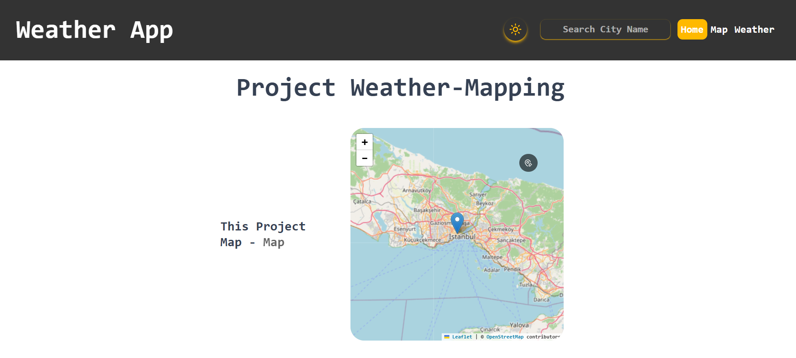
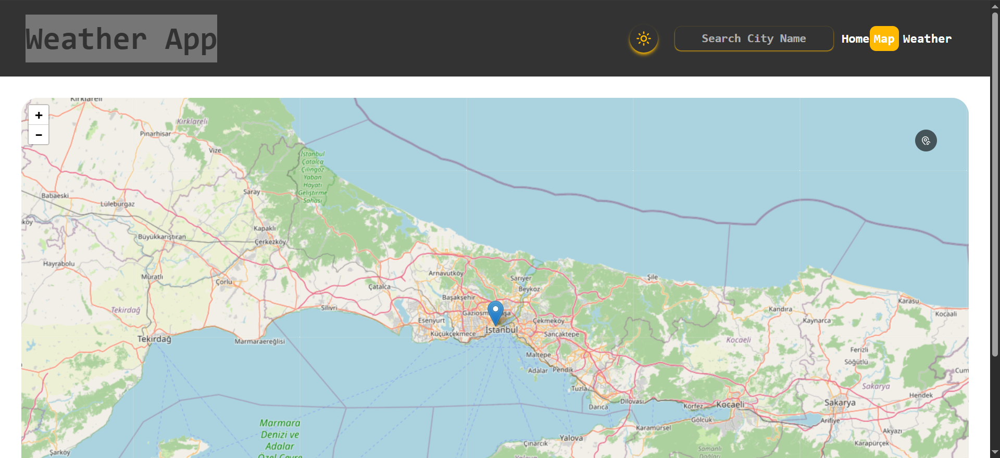
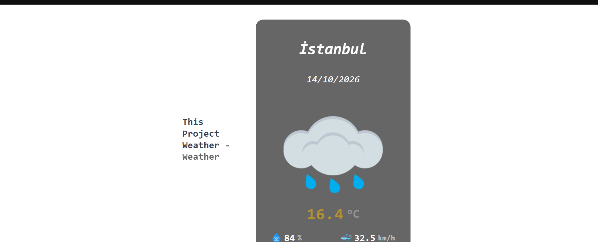
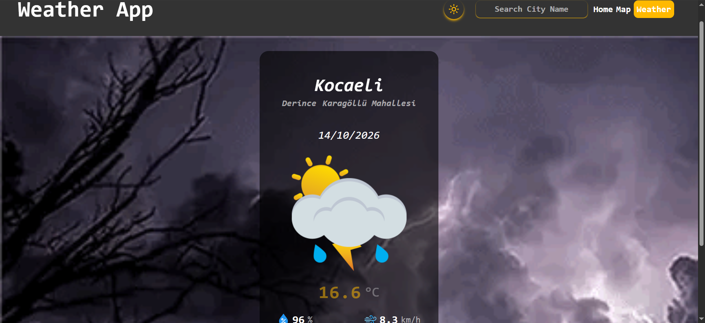
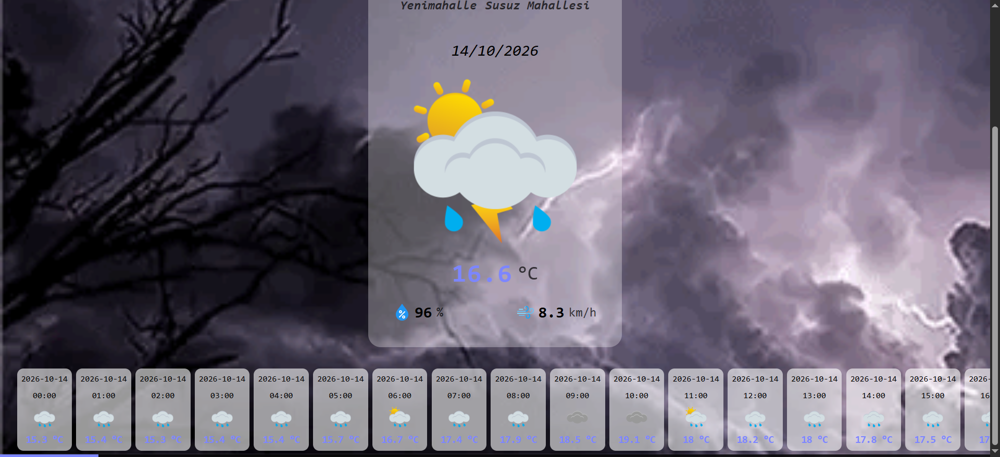

# Weather-Map 🌦️🗺️

Haritada gezip istediğin noktaya tıkladığında o konumun anlık ve saatlik hava durumunu gösteren bir React uygulaması. Şehir adıyla arama yapabilir, açık/koyu tema arasında geçiş yapabilir ve hava koduna göre değişen animasyonlu arka planları görebilirsin.

Hava durumu verisi için API anahtarı gerekmez, uygulama [Open-Meteo](https://open-meteo.com/) servisini kullanır.

## Ekran görüntüleri

| Ana sayfa                               | Harita                                      |
| --------------------------------------- | ------------------------------------------- |
|  |  |

| Anlık hava durumu kartı                                    | Hava durumuna göre arka plan                         |
| ---------------------------------------------------------- | ---------------------------------------------------- |
|  |  |

**Saatlik hava durumu:** Anlık hava durumu kartının altında, yatay kaydırılabilen saatlik liste yer alır. Her kart saati, hava durumu ikonunu ve sıcaklığı gösterir.



## Özellikler

- **Etkileşimli harita:** Leaflet ve OpenStreetMap karoları ile yakınlaştırma, kaydırma ve konum işaretleme.
- **Tıkla ve öğren:** Haritada bir noktaya tıkladığında koordinat, Nominatim ile şehir / ilçe / mahalle bilgisine çevrilir ve o konumun hava durumu getirilir.
- **Şehir arama:** Üst menüdeki arama kutusuna şehir adını yazıp Enter'a basarak konuma git.
- **Konumum:** Haritadaki konum ikonunu açıp haritaya tıkladığında tarayıcının konum bilgisi ile bulunduğun yere gider.
- **Anlık ve saatlik tahmin:** Sıcaklık, nem, rüzgâr hızı ve saatlik sıcaklık listesi.
- **Dinamik görünüm:** Hava koduna (güneşli, bulutlu, yağmurlu, fırtınalı, karlı, sisli…) göre hem ikon hem arka plan animasyonu değişir.
- **Açık / koyu tema:** Tercih tarayıcıda saklanır, sayfa yenilense de korunur.
- **Son konumu hatırlama:** Seçtiğin konum `localStorage`'da saklanır.
- **Duyarlı tasarım:** Mobil ve masaüstü ekranlara uyumlu menü ve yerleşim.

## Kullanılan teknolojiler

| Alan           | Teknoloji                  |
| -------------- | -------------------------- |
| Arayüz         | React 19, React Router 7   |
| Durum yönetimi | Redux Toolkit, React Redux |
| Harita         | Leaflet, React-Leaflet     |
| Stil           | Tailwind CSS 4             |
| İkonlar        | Lucide React               |
| HTTP           | Axios                      |
| Derleme        | Vite                       |

## Kullanılan servisler

| Servis                                                                              | Ne için kullanılıyor              | API anahtarı |
| ----------------------------------------------------------------------------------- | --------------------------------- | ------------ |
| [Open-Meteo Forecast](https://open-meteo.com/en/docs)                               | Anlık ve saatlik hava durumu      | Gerekmez     |
| [Open-Meteo Geocoding](https://open-meteo.com/en/docs/geocoding-api)                | Şehir adından koordinat bulma     | Gerekmez     |
| [Nominatim (OpenStreetMap)](https://nominatim.org/release-docs/latest/api/Reverse/) | Tıklanan koordinattan adres bulma | Gerekmez     |
| [OpenStreetMap](https://www.openstreetmap.org/)                                     | Harita karoları                   | Gerekmez     |

## Kurulum

Gereksinimler: [Node.js](https://nodejs.org/) (güncel LTS sürüm önerilir) ve npm.

```bash
# 1. Depoyu klonla
git clone https://github.com/BerkOzerr/weather-map-project.git
cd weather-map-project

# 2. Bağımlılıkları yükle
npm install

# 3. Ortam değişkenlerini tanımla (aşağıya bak)

# 4. Geliştirme sunucusunu başlat
npm run dev
```

Uygulama varsayılan olarak `http://localhost:5173` adresinde açılır.

### Ortam değişkenleri

Proje kök dizininde bir `.env` dosyası oluştur:

```env
VITE_URL=https://tile.openstreetmap.org/{z}/{x}/{y}.png
VITE_ATT=&copy; <a href="https://www.openstreetmap.org/copyright">OpenStreetMap</a> contributors
```

| Değişken   | Açıklama                                        |
| ---------- | ----------------------------------------------- |
| `VITE_URL` | Harita karolarının URL şablonu                  |
| `VITE_ATT` | Haritanın köşesinde gösterilen kaynak belirtimi |

> `VITE_` ile başlayan değişkenler tarayıcıya gömülür, bu yüzden buraya gizli anahtar koyma.

## Komutlar

| Komut             | Açıklama                         |
| ----------------- | -------------------------------- |
| `npm run dev`     | Geliştirme sunucusunu başlatır   |
| `npm run build`   | Üretim için derler (`dist/`)     |
| `npm run preview` | Derlenmiş sürümü yerelde önizler |
| `npm run lint`    | ESLint ile kodu denetler         |

## Sayfalar

| Yol        | İçerik                                                      |
| ---------- | ----------------------------------------------------------- |
| `/`        | Küçük harita ve anlık hava durumu özeti                     |
| `/map`     | Tam boyutlu harita                                          |
| `/weather` | Anlık hava durumu kartı, saatlik liste ve dinamik arka plan |

## Proje yapısı

```text
src/
├── component/        Sayfalar ve arayüz bileşenleri
│   ├── Header.jsx          Menü, şehir arama, tema düğmesi
│   ├── Mapping.jsx         Harita, işaretçi ve "konumum" düğmesi
│   ├── SetViewOnClick.jsx  Haritaya tıklamayı yakalar, adres sorgusunu tetikler
│   ├── LocationMarker.jsx  Tarayıcı konumunu bulur
│   ├── CurrentWeather*.jsx Anlık hava durumu ve kartı
│   └── HourlyWeather*.jsx  Saatlik liste ve kartları
├── lib/              Yardımcılar
│   ├── axios.js            Axios istemcisi
│   ├── wCode.js            Hava koduna göre arka plan seçimi
│   └── weather*CodeMap.js  Hava koduna göre ikon eşlemeleri
├── redux/
│   ├── store.js
│   └── slice/
│       ├── mapSlice.js       Konum, şehir bilgisi, arama ve adres sorguları
│       ├── weatherSlice.js   Hava durumu istekleri ve verisi
│       └── themaSlice.js     Açık / koyu tema
├── assets/           Hava durumu ikonları (128, 256, 512 px)
├── App.jsx           Rotalar ve tema uygulaması
└── main.jsx          Giriş noktası
public/               Arka plan animasyonları (gif / webp)
```

## Uygulama nasıl çalışıyor?

1. Haritaya tıklanınca `SetViewOnClick`, `reverseGeoCode` işlemini tetikler ve Nominatim'den adres bilgisi alınır.
2. `mapSlice` yeni konumu ve şehir bilgisini günceller ve `localStorage`'a yazar.
3. Konum değişince hava durumu bileşenleri Open-Meteo'dan anlık ve saatlik veriyi ister.
4. `weatherSlice` veriyi saklar, kartlar ve `wCode` ile seçilen arka plan ekrana yansır.

## Bilinen sorunlar ve yol haritası

Bunlar henüz düzeltilmedi, sıradaki iyileştirmeler:

- [ ] Haritada konum değişince hava durumu kartının her zaman yeni konumun verisini göstermesi
- [ ] Şehir arama sonrası sayfa yenilemesi yerine haritanın yeni konuma kayması
- [ ] Bulunamayan şehir ve ağ hataları için kullanıcıya hata mesajı gösterilmesi
- [ ] Tarih ve saatlerin seçilen konumun saat dilimine göre gösterilmesi (`timezone=auto`)
- [ ] Tüm hava kodları için (kar ve şiddetli fırtına dahil) doğru arka plan ve ikon
- [ ] Arka plan animasyonlarının boyutunun küçültülmesi (video formatına geçiş)
- [ ] Erişilebilirlik: tıklanabilir öğelerin `button` olması, form etiketleri
- [ ] Saatlik listenin okunabilir saat biçiminde gösterilmesi

## Katkıda bulunma

Hata bildirimi ve önerileriniz için issue açabilir, değişiklikler için pull request gönderebilirsiniz.

## Lisans ve kaynaklar

- Lisans: henüz belirtilmedi. Paylaşmak istediğin lisansı (örneğin MIT) `LICENSE` dosyası olarak ekle.
- Hava durumu verisi: [Open-Meteo](https://open-meteo.com/) (CC BY 4.0). Kullanım koşulları için sitelerine bak.
- Harita verisi: © [OpenStreetMap](https://www.openstreetmap.org/copyright) katkıda bulunanlar.
- Adres sorguları: [Nominatim](https://operations.osmfoundation.org/policies/nominatim/) kullanım politikasına tabidir (saniyede en fazla 1 istek).
- Hava durumu ikonları ve arka plan animasyonlarının kaynağı ile lisansı: _buraya ekle_.

---

Geliştirici: [BerkOzerr](https://github.com/BerkOzerr)
